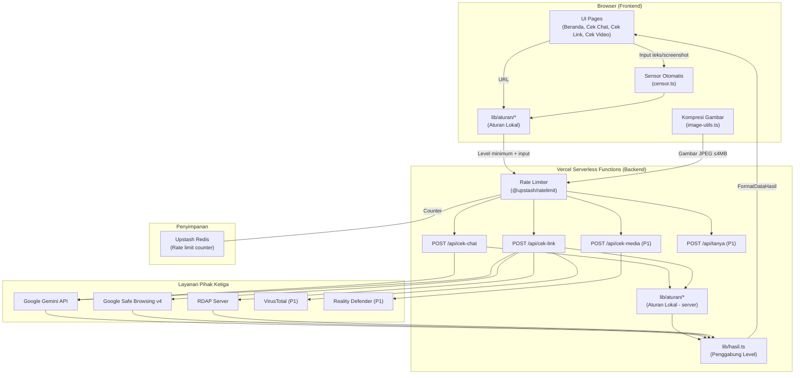
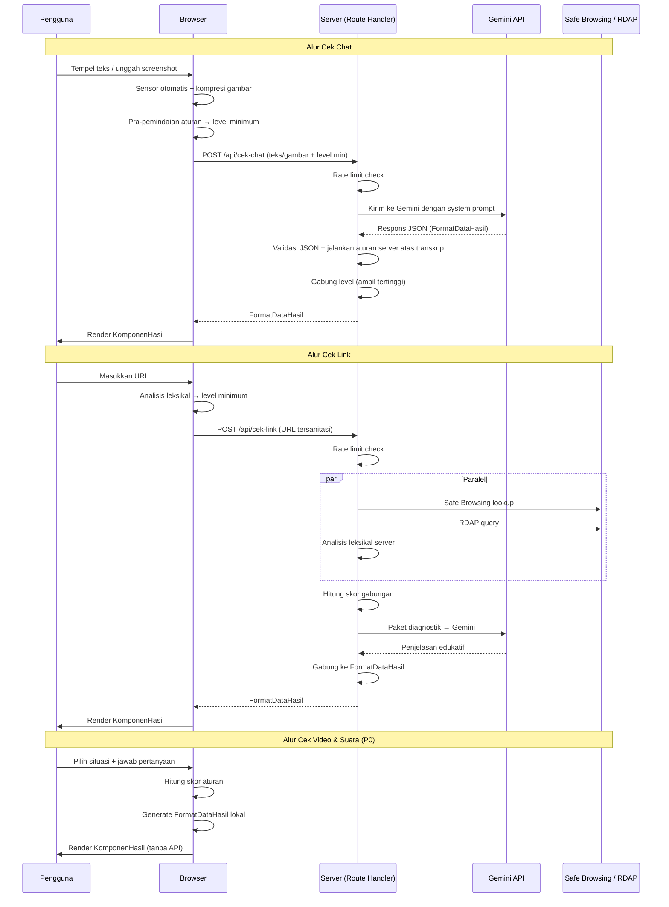
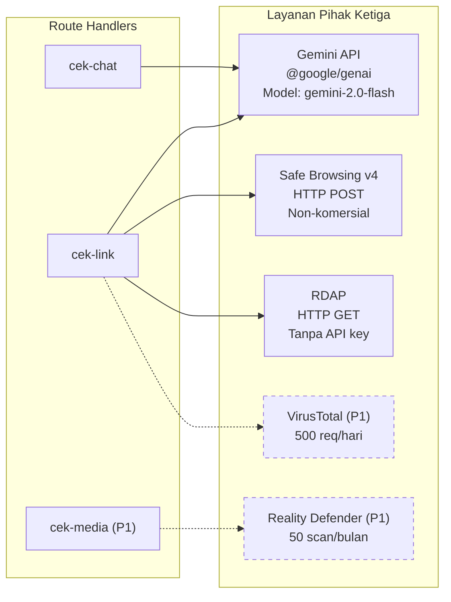
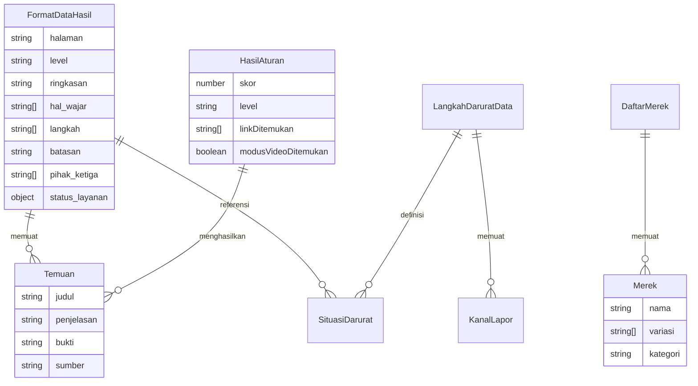

# Design Document: Aplikasi Web Cek Penipuan

## Overview

Aplikasi Web Cek Penipuan adalah aplikasi web berbasis Next.js yang membantu anak muda Indonesia (18+) memeriksa chat, link, dan video/suara mencurigakan terhadap pola penipuan digital. Aplikasi terdiri dari empat halaman — Beranda, Cek Chat, Cek Link, dan Cek Video & Suara — yang masing-masing mengikuti alur seragam: masukkan input → lihat hasil + alasan → ikuti langkah tindakan.

### Prinsip Desain Teknis

1. **Rules-first, AI-second**: Aturan lokal (regex, skor, daftar merek) berjalan di browser terlebih dahulu dan menghasilkan level minimum. AI (Gemini) hanya boleh menaikkan level, tidak pernah menurunkannya. Ini memastikan hasil tetap ada walau AI gagal.
2. **Satu format, satu komponen**: Semua halaman cek menghasilkan objek `FormatDataHasil` yang sama, sehingga satu `KomponenHasil` React bisa dipakai ulang di tiga halaman.
3. **Privacy by design**: Sensor otomatis di browser, tidak ada penyimpanan permanen, API key hanya di server, dan log tanpa isi input.
4. **Graceful degradation**: Setiap sumber pemeriksaan (Gemini, Safe Browsing, RDAP) punya timeout dan fallback independen. Alur utama selalu selesai.

### Keputusan Teknis Utama

| Keputusan | Pilihan | Alasan |
|-----------|---------|--------|
| Framework | Next.js 14+ App Router | SSR/SSG untuk Beranda, Route Handlers untuk API, deploy 1-klik di Vercel |
| Bahasa | TypeScript strict mode | Type safety untuk format data bersama dan validasi |
| Styling | Tailwind CSS | Utility-first, responsive design cepat, konsisten dengan PRD |
| AI SDK | `@google/genai` | SDK resmi Google untuk Gemini API, mendukung structured output dan multimodal |
| Rate limiting | Upstash Redis + `@upstash/ratelimit` | Connectionless (HTTP), cocok untuk serverless Vercel, tidak hilang saat cold start |
| Deployment | Vercel | Sesuai PRD, mendukung serverless functions, edge middleware |

---

## Architecture

### Diagram Arsitektur Tingkat Tinggi



### Alur Data per Halaman



### Pola Arsitektur

- **Isomorphic Rules**: Folder `lib/aturan/` ditulis dalam TypeScript murni tanpa dependensi browser atau server, sehingga bisa di-import oleh keduanya. Ini menghindari duplikasi logika aturan.
- **Backend-for-Frontend (BFF)**: Route Handlers di `app/api/` bertindak sebagai proxy ke layanan pihak ketiga, menyembunyikan API key dari browser.
- **Edge Middleware**: Rate limiting dijalankan di Vercel Edge Middleware sebelum request mencapai Route Handler, sehingga request yang melebihi batas ditolak lebih awal.

---

## Components and Interfaces

### Struktur Folder Proyek

```
project-root/
├── app/
│   ├── layout.tsx              # Root layout dengan Header + Footer
│   ├── page.tsx                # Beranda (/)
│   ├── cek-chat/
│   │   └── page.tsx            # Cek Chat (/cek-chat)
│   ├── cek-link/
│   │   └── page.tsx            # Cek Link (/cek-link)
│   ├── cek-video-suara/
│   │   └── page.tsx            # Cek Video & Suara (/cek-video-suara)
│   └── api/
│       ├── cek-chat/
│       │   └── route.ts        # POST /api/cek-chat
│       ├── cek-link/
│       │   └── route.ts        # POST /api/cek-link
│       ├── cek-media/
│       │   └── route.ts        # POST /api/cek-media (P1)
│       └── tanya/
│           └── route.ts        # POST /api/tanya (P1)
├── components/
│   ├── layout/
│   │   ├── Header.tsx          # Navigasi + nama aplikasi
│   │   └── Footer.tsx          # Footer + catatan 18+
│   ├── hasil/
│   │   ├── KomponenHasil.tsx   # Komponen hasil bersama
│   │   ├── TingkatKewaspadaan.tsx  # Label + ikon level
│   │   ├── KartuTemuan.tsx     # Satu temuan dengan alasan + bukti
│   │   ├── LangkahDisarankan.tsx   # Daftar langkah
│   │   └── PanelDarurat.tsx    # Panel "Sudah terlanjur?"
│   ├── input/
│   │   ├── InputChat.tsx       # Tab teks + screenshot
│   │   ├── InputLink.tsx       # Kolom URL
│   │   ├── WizardVideoSuara.tsx    # Wizard 4 langkah
│   │   └── TombolContoh.tsx    # Tombol "Coba contoh"
│   ├── shared/
│   │   ├── KotakPrivasi.tsx    # Peringatan privasi per halaman
│   │   ├── Akordeon.tsx        # Akordeon reusable
│   │   └── KartuMenu.tsx       # Kartu menu di Beranda
│   └── PratinjauSensor.tsx     # Modal pratinjau teks tersensor
├── lib/
│   ├── aturan/
│   │   ├── index.ts            # Ekspor semua aturan
│   │   ├── chat-rules.ts       # Aturan pra-pemindaian chat
│   │   ├── link-rules.ts       # Aturan analisis leksikal URL
│   │   ├── video-rules.ts      # Aturan skor video & suara
│   │   └── scoring.ts          # Logika penghitungan skor → level
│   ├── hasil.ts                # Tipe FormatDataHasil + fungsi penggabungan level
│   ├── sensor.ts               # Fungsi sensor otomatis
│   ├── sanitasi-url.ts         # Parsing + sanitasi URL
│   ├── image-utils.ts          # Kompresi gambar di browser
│   ├── gemini.ts               # Helper pemanggilan Gemini API
│   ├── safe-browsing.ts        # Helper Safe Browsing API
│   ├── rdap.ts                 # Helper RDAP query
│   └── rate-limit.ts           # Konfigurasi Upstash rate limiter
├── data/
│   ├── langkah-darurat.json    # Data langkah darurat per situasi
│   ├── merek.json              # Daftar merek Indonesia untuk deteksi
│   ├── tld-berisiko.json       # Daftar TLD yang sering disalahgunakan
│   ├── system-prompt.ts        # System prompt untuk Gemini
│   └── contoh/
│       ├── chat-contoh.json    # 3 skenario fiktif Cek Chat
│       ├── link-contoh.json    # Contoh URL + respons simulasi
│       └── video-contoh.json   # 3 skenario fiktif Video & Suara
├── middleware.ts               # Edge middleware untuk rate limiting
├── tailwind.config.ts
├── tsconfig.json
└── .env.local                  # API keys (tidak di-commit)
```

### Komponen UI Utama

#### 1. Header (`components/layout/Header.tsx`)

```typescript
interface HeaderProps {
  currentPath: string;
}
```

- Menampilkan nama aplikasi dan tiga tautan navigasi ke halaman cek.
- Menandai halaman aktif dengan style berbeda.
- Responsive: hamburger menu di mobile ≤640px.

#### 2. KomponenHasil (`components/hasil/KomponenHasil.tsx`)

```typescript
interface KomponenHasilProps {
  hasil: FormatDataHasil;
  halamanLain: Array<{ label: string; href: string }>;
  onCekLagi: () => void;
  crossLinks?: CrossLink[];  // Tombol "Cek link ini" atau tautan ke Video & Suara
}
```

- Menerima objek `FormatDataHasil` dan merender seluruh susunan hasil sesuai Requirement 6.
- Urutan render: TingkatKewaspadaan → Temuan → HalWajar → Langkah → PanelDarurat → Batasan → TombolCekLagi.

#### 3. PanelDarurat (`components/hasil/PanelDarurat.tsx`)

```typescript
interface PanelDaruratProps {
  situasiAktif?: SituasiDarurat;  // Auto-open jika AI/aturan mendeteksi
  langkahDarurat: LangkahDaruratData; // Dari langkah-darurat.json
  autoOpen: boolean;
}

type SituasiDarurat = 'klik_link' | 'isi_data' | 'kirim_otp' | 'transfer' | 'akun_diambil';
```

- Memuat langkah darurat dari `data/langkah-darurat.json`.
- Jika `autoOpen` true, panel langsung terbuka di posisi teratas.

#### 4. WizardVideoSuara (`components/input/WizardVideoSuara.tsx`)

```typescript
interface WizardVideoSuaraProps {
  onHasilReady: (hasil: FormatDataHasil) => void;
}

interface WizardState {
  langkah: 1 | 2 | 3 | 4;
  situasi: 'video_call' | 'rekaman' | 'tokoh' | null;
  jawaban: Record<string, string | boolean>;
  checklist: string[];  // P1
}
```

- Wizard 4 langkah yang berjalan sepenuhnya di browser.
- Menghasilkan `FormatDataHasil` tanpa memanggil API.

#### 5. InputChat (`components/input/InputChat.tsx`)

```typescript
interface InputChatProps {
  onSubmit: (data: ChatInput) => Promise<void>;
  isLoading: boolean;
}

interface ChatInput {
  mode: 'teks' | 'screenshot';
  teks?: string;
  gambar?: File[];
  konteks?: string;
}
```

- Dua tab: tempel teks dan unggah screenshot.
- Validasi: teks maks 4.000 karakter, gambar maks 5 file (JPG/PNG/WebP).
- Memanggil sensor otomatis dan menampilkan pratinjau sebelum pengiriman.

### Interface API (Route Handlers)

#### POST /api/cek-chat

```typescript
// Request
interface CekChatRequest {
  mode: 'teks' | 'screenshot';
  teks?: string;              // Teks yang sudah disensor
  gambar?: string[];           // Base64 JPEG, sudah dikompres
  konteks?: string;
  levelMinimum: TingkatLevel;  // Dari pra-pemindaian browser
  temuanAturan: Temuan[];      // Temuan dari aturan lokal browser
}

// Response: FormatDataHasil (lihat Data Models)
```

**Alur internal:**
1. Validasi request body (ukuran ≤4MB, tipe file magic bytes).
2. Kirim ke Gemini dengan system prompt + skema JSON.
3. Validasi JSON dari Gemini. Jika tidak valid, gunakan hasil aturan saja.
4. Untuk screenshot: jalankan aturan server atas transkrip dari Gemini.
5. Gabung level: `Math.max(levelAturan, levelAI)`.
6. Return `FormatDataHasil`.

#### POST /api/cek-link

```typescript
// Request
interface CekLinkRequest {
  url: string;                 // URL yang sudah disanitasi
  levelMinimum: TingkatLevel;
  temuanAturan: Temuan[];
}

// Response: FormatDataHasil
```

**Alur internal:**
1. Parse URL menjadi komponen (protokol, subdomain, domain, TLD, path, params).
2. Buang parameter sensitif.
3. Jalankan paralel dengan `Promise.allSettled` dan timeout 5 detik per sumber:
   - Safe Browsing Lookup API
   - RDAP query untuk tanggal registrasi
   - Analisis leksikal server (merek, punycode, IP, dll.)
4. Hitung skor gabungan dari semua sumber.
5. Kirim paket diagnostik (tanpa data pengguna) ke Gemini untuk penjelasan.
6. Jika Gemini gagal, gunakan teks penjelasan bawaan per aturan.
7. Return `FormatDataHasil`.

#### POST /api/cek-media (P1)

```typescript
// Request
interface CekMediaRequest {
  tipe: 'gambar' | 'audio';
  data: string;  // Base64
}

// Response: FormatDataHasil
```

#### POST /api/tanya (P1)

```typescript
// Request
interface TanyaRequest {
  pertanyaan: string;
  konteksHasil: FormatDataHasil;  // Hasil pemeriksaan sebelumnya
  riwayat: Array<{ peran: 'pengguna' | 'asisten'; isi: string }>;
}

// Response
interface TanyaResponse {
  jawaban: string;
}
```

### Helper Modules

#### `lib/gemini.ts` — Pemanggilan Gemini API

```typescript
interface GeminiConfig {
  model: string;       // "gemini-2.0-flash" atau model terbaru
  systemPrompt: string;
  responseSchema: object;  // JSON Schema untuk structured output
  timeout: number;         // 20.000 ms untuk chat, 10.000 ms untuk link
}

async function analyzeChat(input: CekChatRequest, config: GeminiConfig): Promise<FormatDataHasil | null>;
async function explainLink(diagnostik: PaketDiagnostik, config: GeminiConfig): Promise<FormatDataHasil | null>;
```

- Menggunakan `@google/genai` SDK dengan structured output (JSON mode).
- Timeout dan error handling: return `null` jika gagal, caller menggunakan fallback.

#### `lib/safe-browsing.ts` — Google Safe Browsing

```typescript
interface SafeBrowsingResult {
  ditemukan: boolean;
  ancaman: string[];  // ['SOCIAL_ENGINEERING', 'MALWARE', ...]
}

async function checkUrl(url: string): Promise<SafeBrowsingResult>;
```

- Menggunakan Safe Browsing v4 Lookup API via HTTP POST.
- Mengirim `threatTypes: ['MALWARE', 'SOCIAL_ENGINEERING', 'UNWANTED_SOFTWARE', 'POTENTIALLY_HARMFUL_APPLICATION']`.

#### `lib/rdap.ts` — Pengecekan Umur Domain

```typescript
interface RdapResult {
  tersedia: boolean;
  tanggalRegistrasi?: Date;
  umurHari?: number;
}

async function queryDomainAge(domain: string): Promise<RdapResult>;
```

- Query ke `https://rdap.org/domain/{domain}` (bootstrap RDAP).
- Parse JSON response, cari event `registration` untuk tanggal registrasi.
- Jika TLD tidak mendukung RDAP, return `{ tersedia: false }`.

#### `lib/sensor.ts` — Sensor Otomatis

```typescript
function sensorTeks(teks: string): { hasil: string; jumlahDiganti: number };
```

- Regex patterns untuk mendeteksi dan mengganti:
  - Nomor HP Indonesia: `/(\+?62|0)\d{8,12}/g`
  - Deretan 4-8 angka: `/\b\d{4,8}\b/g`
  - Email: `/[\w.-]+@[\w.-]+\.\w+/g`
  - Nomor rekening (10-16 digit): `/\b\d{10,16}\b/g`
- Semua diganti dengan `[disensor]`.
- Berjalan di browser, tidak mengirim data ke server.

#### `lib/sanitasi-url.ts` — Parsing dan Sanitasi URL

```typescript
interface UrlParsed {
  protokol: string;
  subdomain: string;
  domainUtama: string;
  tld: string;
  path: string;
  params: Record<string, string>;
  urlAsli: string;
  urlBersih: string;  // Tanpa params sensitif
}

function parseUrl(input: string): UrlParsed;
function sanitasiParams(parsed: UrlParsed): UrlParsed;
```

- Membuang parameter sensitif: `email`, `phone`, `token`, `session`, `id`, `password`, `otp`.

#### `lib/rate-limit.ts` — Konfigurasi Rate Limiter

```typescript
import { Ratelimit } from '@upstash/ratelimit';
import { Redis } from '@upstash/redis';

const redis = new Redis({
  url: process.env.UPSTASH_REDIS_REST_URL!,
  token: process.env.UPSTASH_REDIS_REST_TOKEN!,
});

// Per halaman: 10 req/menit, 100 req/hari
export const rateLimitPerMinute = new Ratelimit({
  redis,
  limiter: Ratelimit.slidingWindow(10, '1 m'),
  prefix: 'rl:min',
});

export const rateLimitPerDay = new Ratelimit({
  redis,
  limiter: Ratelimit.slidingWindow(100, '1 d'),
  prefix: 'rl:day',
});
```

### Integrasi Layanan Pihak Ketiga



---

## Data Models

### FormatDataHasil — Objek Hasil Bersama

Ini adalah model data inti yang dipakai di seluruh aplikasi. Semua endpoint backend dan logika browser menghasilkan objek ini.

```typescript
// lib/hasil.ts

/** Tingkat kewaspadaan yang ditampilkan ke pengguna */
type TingkatLevel = 'tinggi' | 'sedang' | 'tidak_ditemukan';

/** Halaman asal pemeriksaan */
type HalamanCek = 'chat' | 'link' | 'video';

/** Sumber temuan */
type SumberTemuan = 'aturan' | 'ai' | 'safe_browsing' | 'rdap' | 'virustotal' | 'reality_defender';

/** Status layanan pihak ketiga */
type StatusLayanan = 'ok' | 'gagal' | 'tidak_dipakai';

/** Satu temuan mencurigakan */
interface Temuan {
  judul: string;           // "Meminta kode OTP"
  penjelasan: string;      // Kenapa berisiko + cara kerja modus
  bukti: string;           // Kutipan kalimat atau bagian URL
  sumber: SumberTemuan;
}

/** Objek hasil bersama yang dipakai di semua halaman cek */
interface FormatDataHasil {
  halaman: HalamanCek;
  level: TingkatLevel;
  ringkasan: string;       // 1-2 kalimat pembuka
  temuan: Temuan[];         // Minimal 1 temuan jika level > tidak_ditemukan
  hal_wajar: string[];      // Hal yang tampak wajar (bisa kosong)
  langkah: string[];        // Minimal 2 langkah
  situasi_darurat: SituasiDarurat[];
  batasan: string;          // Keterangan batasan hasil
  pihak_ketiga: string[];   // ["Google Gemini", "Google Safe Browsing"]
  status_layanan: Record<string, StatusLayanan>;
}

type SituasiDarurat = 'klik_link' | 'isi_data' | 'kirim_otp' | 'transfer' | 'akun_diambil';
```

### Data Aturan — Daftar Merek Indonesia

```typescript
// data/merek.json
interface DaftarMerek {
  merek: Array<{
    nama: string;         // "BCA"
    variasi: string[];    // ["bca", "b.c.a", "bc4"]
    kategori: 'bank' | 'ewallet' | 'marketplace' | 'ekspedisi' | 'instansi';
  }>;
}
```

Contoh data:
```json
{
  "merek": [
    { "nama": "BCA", "variasi": ["bca", "b.c.a", "bc4", "bc@"], "kategori": "bank" },
    { "nama": "BRI", "variasi": ["bri", "br1", "brii"], "kategori": "bank" },
    { "nama": "Shopee", "variasi": ["shopee", "sh0pee", "shop3e", "shopie"], "kategori": "marketplace" },
    { "nama": "DANA", "variasi": ["dana", "d4na"], "kategori": "ewallet" },
    { "nama": "JNE", "variasi": ["jne", "jn3"], "kategori": "ekspedisi" },
    { "nama": "BPJS", "variasi": ["bpjs", "bpj5"], "kategori": "instansi" }
  ]
}
```

### Data Langkah Darurat

```typescript
// data/langkah-darurat.json
interface LangkahDaruratData {
  situasi: Array<{
    id: SituasiDarurat;
    label: string;
    langkah: string[];
  }>;
  kanal_lapor: Array<{
    nama: string;
    kontak: string;
    keterangan: string;
  }>;
  peringatan: string;  // Waspadai pihak yang mengaku IASC
}
```

### Data Contoh — Skenario Fiktif

```typescript
// data/contoh/chat-contoh.json
interface ContohChat {
  skenario: Array<{
    id: string;
    judul: string;          // "Tawaran kerja like & review"
    teks: string;           // Isi chat fiktif
    konteks?: string;       // "dari nomor tidak dikenal"
    hasilSimulasi: FormatDataHasil;  // Respons yang sudah disiapkan
  }>;
}

// data/contoh/link-contoh.json
interface ContohLink {
  skenario: Array<{
    id: string;
    judul: string;
    url: string;            // URL fiktif (domain tidak terdaftar)
    responsSimulasi: {
      safeBrowsing: SafeBrowsingResult;
      rdap: RdapResult;
      leksikal: Temuan[];
    };
    hasilSimulasi: FormatDataHasil;
  }>;
}

// data/contoh/video-contoh.json
interface ContohVideo {
  skenario: Array<{
    id: string;
    judul: string;
    situasi: 'video_call' | 'rekaman' | 'tokoh';
    jawaban: Record<string, string | boolean>;
    hasilSimulasi: FormatDataHasil;
  }>;
}
```

### Model Aturan dan Skor

```typescript
// lib/aturan/scoring.ts

/** Satu aturan yang bisa dipicu */
interface Aturan {
  id: string;
  pola: RegExp | ((input: string) => boolean);
  bobot: number;           // Skor yang ditambahkan
  langsung_tinggi: boolean; // true = langsung waspada tinggi
  judul: string;
  penjelasan: string;      // Teks penjelasan bawaan (fallback)
  buktiExtractor: (input: string, match: RegExpMatchArray | null) => string;
}

/** Hasil evaluasi aturan */
interface HasilAturan {
  skor: number;
  level: TingkatLevel;
  temuan: Temuan[];
  linkDitemukan: string[];   // URL yang ditemukan di teks (untuk cross-link)
  modusVideoDitemukan: boolean; // Modus video call/voice note terdeteksi
}

/** Ambang batas skor → level */
const AMBANG_TINGGI = 6;
const AMBANG_SEDANG = 3;

function hitungLevel(skor: number, adaLangsungTinggi: boolean): TingkatLevel {
  if (adaLangsungTinggi || skor >= AMBANG_TINGGI) return 'tinggi';
  if (skor >= AMBANG_SEDANG) return 'sedang';
  return 'tidak_ditemukan';
}

/** Gabung dua level, ambil yang tertinggi */
function gabungLevel(a: TingkatLevel, b: TingkatLevel): TingkatLevel {
  const urutan: Record<TingkatLevel, number> = {
    'tinggi': 2,
    'sedang': 1,
    'tidak_ditemukan': 0,
  };
  return urutan[a] >= urutan[b] ? a : b;
}
```

### Model Request/Response API

```typescript
// Konfigurasi environment variables
interface EnvConfig {
  GEMINI_API_KEY: string;
  SAFE_BROWSING_API_KEY: string;
  UPSTASH_REDIS_REST_URL: string;
  UPSTASH_REDIS_REST_TOKEN: string;
  VIRUSTOTAL_API_KEY?: string;        // P1
  REALITY_DEFENDER_API_KEY?: string;   // P1
}
```

### Diagram Relasi Data




---

## Correctness Properties

*A property is a characteristic or behavior that should hold true across all valid executions of a system — essentially, a formal statement about what the system should do. Properties serve as the bridge between human-readable specifications and machine-verifiable correctness guarantees.*

Properti-properti berikut diturunkan dari acceptance criteria di dokumen requirements melalui analisis prework. Setiap properti bersifat universal (berlaku untuk semua input yang valid) dan bisa diimplementasi sebagai property-based test.

### Property 1: Round-trip serialisasi FormatDataHasil

*For any* objek `FormatDataHasil` yang valid, melakukan serialisasi ke JSON lalu parsing kembali SHALL menghasilkan objek yang setara secara struktural dan semantik dengan objek aslinya.

**Validates: Requirements 5.5, 32.5**

> **Rasional**: FormatDataHasil adalah kontrak data inti yang menghubungkan backend, frontend, dan ketiga halaman cek. Round-trip ini memastikan tidak ada data yang hilang atau berubah saat dikirim melintasi boundary (server → network → browser, atau browser → komponen React → pembacaan kembali).

---

### Property 2: Monotonisitas level — AI tidak pernah menurunkan

*For any* pasangan `(levelAturanLokal, levelAI)`, hasil `gabungLevel(levelAturanLokal, levelAI)` SHALL selalu lebih besar atau sama dengan `levelAturanLokal`. Dengan kata lain, `gabungLevel(a, b) >= a` untuk semua nilai `a` dan `b` yang valid.

**Validates: Requirements 10.5, 14.4, 20.2**

> **Rasional**: Prinsip "rules-first" mengharuskan aturan lokal menjadi lantai minimum. AI hanya boleh menaikkan, tidak pernah menurunkan. Properti ini adalah invariant keamanan kritis — jika dilanggar, penipuan yang sudah terdeteksi aturan bisa "dihapus" oleh AI yang salah.

---

### Property 3: Determinisme penghitungan skor → level

*For any* nilai skor integer non-negatif, fungsi `hitungLevel(skor)` SHALL menghasilkan:
- `"tinggi"` jika `skor >= 6` atau ada flag `langsungTinggi`,
- `"sedang"` jika `3 <= skor <= 5` dan tidak ada flag `langsungTinggi`,
- `"tidak_ditemukan"` jika `skor < 3` dan tidak ada flag `langsungTinggi`.

Dan untuk input yang sama, hasilnya selalu sama (idempoten).

**Validates: Requirements 10.1, 10.2, 10.3, 10.4**

> **Rasional**: Fungsi pemetaan skor → level adalah inti dari semua halaman cek. Properti ini memastikan bahwa fungsi tersebut deterministik dan sesuai ambang batas yang didefinisikan di PRD.

---

### Property 4: Skor aturan chat aditif dan deterministik

*For any* teks input chat, skor yang dihasilkan oleh `evaluasiAturanChat(teks)` SHALL sama dengan jumlah bobot dari semua pola yang cocok dalam teks tersebut. Menjalankan fungsi dua kali dengan input yang sama SHALL menghasilkan skor, level, dan daftar temuan yang identik.

**Validates: Requirements 13.2**

> **Rasional**: Aturan chat terdiri dari 11 pola dengan bobot masing-masing. Properti ini memastikan bahwa penghitungan skor bersifat aditif (tidak ada interaksi antar-pola yang mengubah skor secara tak terduga) dan deterministik.

---

### Property 5: Skor aturan video & suara sesuai bobot jawaban

*For any* kombinasi jawaban wizard yang valid, skor yang dihasilkan oleh `evaluasiAturanVideo(jawaban)` SHALL sama dengan jumlah bobot dari semua jawaban yang memicu skor. Jawaban yang tidak memicu skor SHALL tidak mengubah total skor.

**Validates: Requirements 23.1**

> **Rasional**: Halaman Video & Suara menggunakan 12 jawaban berbobot. Properti ini memverifikasi bahwa setiap jawaban berkontribusi tepat sesuai bobotnya tanpa efek samping.

---

### Property 6: Sensor otomatis mengganti semua pola sensitif

*For any* teks input yang mengandung pola sensitif (nomor HP Indonesia, deretan 4-8 angka, alamat email, nomor rekening 10-16 digit), fungsi `sensorTeks(teks)` SHALL menghasilkan teks keluaran di mana semua kemunculan pola tersebut diganti dengan `[disensor]`, dan tidak ada teks di luar pola yang berubah.

**Validates: Requirements 12.1**

> **Rasional**: Sensor otomatis adalah garis pertahanan privasi. Properti ini memastikan bahwa (a) tidak ada pola sensitif yang lolos, dan (b) teks non-sensitif tidak rusak.

---

### Property 7: Sanitasi URL membuang parameter sensitif

*For any* URL yang mengandung parameter sensitif (email, phone, token, session, id, password, otp), fungsi `sanitasiParams(parseUrl(url))` SHALL menghasilkan URL bersih yang tidak lagi mengandung parameter-parameter tersebut, dan parameter non-sensitif tetap utuh.

**Validates: Requirements 17.4**

> **Rasional**: Sebelum URL dikirim ke Safe Browsing dan RDAP, parameter sensitif harus dibuang. Ini adalah transformasi yang harus menjamin tidak ada kebocoran data pengguna ke pihak ketiga.

---

### Property 8: Deteksi kemiripan merek mencakup substitusi karakter

*For any* string domain yang merupakan variasi dari merek Indonesia yang terdaftar di `data/merek.json` (termasuk substitusi angka pengganti huruf seperti `0→o`, `1→i`, `3→e`, `4→a`, `5→s`), fungsi `deteksiMerek(domain)` SHALL mengembalikan kecocokan dengan merek yang sesuai dan skor +3.

**Validates: Requirements 19.2**

> **Rasional**: Penipu sering menggunakan domain yang mirip merek terkenal dengan substitusi karakter. Properti ini memastikan deteksi mencakup semua variasi yang didefinisikan, bukan hanya string literal.

---

### Property 9: Kata terlarang tidak pernah muncul sebagai kesimpulan

*For any* objek `FormatDataHasil` yang dihasilkan oleh sistem (baik dari aturan lokal maupun setelah filter keluaran AI), field `ringkasan`, semua `temuan[].penjelasan`, dan semua `langkah[]` SHALL tidak mengandung kata "aman", "pasti", "terbukti", atau "100%" sebagai kesimpulan atau pernyataan pasti.

**Validates: Requirements 2.4, 6.7, 30.1, 30.3**

> **Rasional**: PRD melarang klaim keamanan pasti. Properti ini memastikan filter kata terlarang berfungsi di semua jalur keluaran — baik dari aturan lokal, dari AI, maupun dari teks bawaan.

---

### Property 10: Hasil aturan lokal selalu memenuhi struktur minimum

*For any* input yang valid (teks chat, URL, atau jawaban wizard), hasil dari aturan lokal SHALL selalu menghasilkan objek `FormatDataHasil` yang memuat:
- field `level` dengan nilai valid (`tinggi`, `sedang`, atau `tidak_ditemukan`),
- field `temuan` dengan setidaknya satu temuan yang memiliki `judul`, `penjelasan`, `bukti`, dan `sumber` jika level > `tidak_ditemukan`,
- field `langkah` dengan setidaknya dua langkah,
- field `sumber` pada setiap temuan yang sesuai dengan tipe sumber yang valid.

**Validates: Requirements 5.2, 5.3, 5.4, 6.6, 29.4**

> **Rasional**: Karena aturan lokal adalah fallback terakhir saat semua layanan pihak ketiga gagal, hasil aturan harus selalu memenuhi kontrak minimum agar KomponenHasil bisa merender hasil yang berguna.

---

### Property 11: Deteksi pola leksikal URL bersifat aditif

*For any* URL, skor dari analisis leksikal SHALL sama dengan jumlah bobot semua sinyal yang terdeteksi (kata pemicu +2, TLD berisiko +1, punycode +3, IP +3, dll.). Menambahkan sinyal baru ke URL SHALL menaikkan atau mempertahankan skor, tidak pernah menurunkannya.

**Validates: Requirements 19.6, 19.8, 19.4, 19.5, 19.10**

> **Rasional**: Analisis leksikal URL menggunakan banyak sinyal yang masing-masing punya bobot. Properti aditivitas memastikan bahwa URL dengan lebih banyak tanda bahaya selalu mendapat skor yang lebih tinggi atau sama — tidak ada interaksi negatif antar-sinyal.

---

## Error Handling

### Strategi Error per Layer

#### 1. Browser (Frontend)

| Skenario | Penanganan | UX |
|----------|------------|-----|
| Input kosong | Validasi lokal, tombol Periksa di-disable | Pesan validasi inline |
| Teks melebihi 4.000 karakter | Validasi lokal, potong dan beri peringatan | Counter karakter berubah merah |
| Gambar terlalu besar setelah kompresi | Tolak file, minta gambar lebih kecil | Pesan error di area upload |
| Format file tidak didukung | Cek magic bytes lokal, tolak | Pesan "Format file tidak didukung" |
| Lebih dari 5 gambar | Tolak file ke-6+ | Pesan "Maksimal 5 gambar" |
| Gagal kompresi gambar | Fallback ke ukuran asli, cek total | Log warning ke console |
| Network error saat POST ke API | Tampilkan pesan error + tombol coba lagi | Input dipertahankan |
| Response timeout dari server | Tampilkan hasil aturan lokal jika ada | Pesan "Analisis AI sedang tidak tersedia" |

#### 2. Edge Middleware (Rate Limiting)

| Skenario | Penanganan | Response |
|----------|------------|----------|
| Rate limit per menit terlampaui | Tolak request | `429 Too Many Requests` + `Retry-After` header |
| Rate limit per hari terlampaui | Tolak request | `429` + pesan "Batas harian tercapai, coba lagi besok" |
| Upstash Redis tidak tersedia | Izinkan request (fail-open) | Log error, lanjutkan ke Route Handler |

> **Keputusan: Fail-open untuk rate limiter.** Jika Redis gagal, lebih baik melayani request daripada memblokir semua pengguna. Risiko abuse sementara diterima karena demo/penjurian lebih penting daripada proteksi sempurna.

#### 3. Route Handlers (Backend)

| Skenario | Penanganan | Response |
|----------|------------|----------|
| Body request > 4MB | Tolak sebelum parsing | `413 Payload Too Large` |
| JSON body tidak valid | Tolak | `400 Bad Request` + pesan spesifik |
| Magic bytes tidak sesuai tipe file | Tolak file | `415 Unsupported Media Type` |
| Gemini API error (500, 503, dll.) | Gunakan hasil aturan lokal saja | `200` + `status_layanan.ai: "gagal"` |
| Gemini API timeout (>20 detik) | Abort request, gunakan fallback | `200` + `status_layanan.ai: "gagal"` |
| Gemini JSON tidak valid | Abaikan respons AI, gunakan aturan | `200` + log warning |
| Gemini mengembalikan kata terlarang | Filter kata terlarang dari output | Teks yang sudah dibersihkan |
| Safe Browsing API error | Lanjut tanpa data Safe Browsing | `200` + `status_layanan.safe_browsing: "gagal"` |
| Safe Browsing timeout (>5 detik) | Lanjut tanpa data Safe Browsing | `200` + status "tidak tersedia" |
| RDAP query gagal | Lanjut tanpa data umur domain | `200` + umur domain "tidak tersedia" |
| RDAP timeout (>5 detik) | Lanjut tanpa data umur domain | `200` + status "tidak tersedia" |
| Semua layanan pihak ketiga gagal | Kembalikan hasil aturan lokal saja | `200` + semua status "gagal" |
| Contoh fiktif dipilih | Langsung kembalikan respons simulasi | `200` + data dari `data/contoh/` |

### Prinsip Error Handling

1. **Selalu kembalikan 200 dengan hasil parsial.** Jangan pernah kembalikan error 500 ke pengguna untuk skenario yang bisa di-handle. Hasil aturan lokal selalu tersedia sebagai fallback.

2. **Transparansi status layanan.** Setiap layanan pihak ketiga punya status di `status_layanan`. Pengguna selalu tahu layanan mana yang tersedia dan mana yang gagal.

3. **Input dipertahankan saat error.** Pengguna tidak perlu mengetik ulang. Tombol "Coba lagi" mengirim ulang request yang sama.

4. **Log tanpa isi input.** Error log hanya berisi: timestamp, endpoint, status code, durasi, dan jenis error. Isi teks, URL, atau gambar pengguna tidak pernah masuk log.

### Timeout per Layanan

```typescript
const TIMEOUT = {
  gemini_chat: 20_000,      // 20 detik untuk analisis chat
  gemini_link: 10_000,      // 10 detik untuk penjelasan link
  safe_browsing: 5_000,     // 5 detik
  rdap: 5_000,              // 5 detik
  virustotal: 5_000,        // 5 detik (P1)
  reality_defender: 10_000, // 10 detik (P1)
} as const;
```

### Filter Kata Terlarang

```typescript
const KATA_TERLARANG = ['aman', 'pasti', 'terbukti', '100%'];

function filterKataTerlarang(teks: string): string {
  // Hanya memfilter kata-kata ini saat dipakai sebagai kesimpulan/vonis
  // Bukan saat dipakai dalam konteks edukasi, misalnya:
  // "Ini tidak berarti pasti aman" ← diperbolehkan (negasi)
  // "Link ini aman" ← DILARANG (klaim pasti)
  // Implementasi: cek konteks sekitar kata, bukan replace buta
}
```

---

## Testing Strategy

### Pendekatan Dua Jalur

Testing untuk aplikasi ini mengikuti pendekatan dua jalur yang saling melengkapi:

1. **Property-based tests (PBT)**: Memverifikasi bahwa properti universal berlaku untuk semua input yang valid. Menggunakan input acak yang di-generate untuk menemukan edge case yang tidak terpikirkan.
2. **Example-based tests**: Memverifikasi perilaku spesifik dengan contoh konkret, termasuk edge case dan integrasi antar komponen.

### Library dan Framework

| Aspek | Pilihan | Alasan |
|-------|---------|--------|
| Test runner | Vitest | Cepat, native TypeScript, kompatibel dengan Next.js |
| Property-based testing | `fast-check` | Library PBT paling matang untuk TypeScript, mendukung custom arbitrary generators |
| Component testing | React Testing Library + Vitest | Testing Library mendorong testing dari perspektif pengguna |
| E2E testing | Playwright | Cross-browser (Chrome, Firefox, Safari), mendukung mobile viewport |
| API mocking | MSW (Mock Service Worker) | Intercept network request di level service worker, cocok untuk mock Gemini/Safe Browsing |

### Konfigurasi Property-Based Tests

Setiap property test HARUS:
- Menjalankan minimum **100 iterasi** per properti (karena randomisasi)
- Menyertakan tag referensi ke properti di dokumen desain
- Format tag: **Feature: cek-penipuan-web, Property {nomor}: {judul properti}**

Contoh konfigurasi:
```typescript
import { fc } from 'fast-check';

// Feature: cek-penipuan-web, Property 1: Round-trip serialisasi FormatDataHasil
test('FormatDataHasil round-trip', () => {
  fc.assert(
    fc.property(
      arbitraryFormatDataHasil(),  // Custom generator
      (hasil) => {
        const json = JSON.stringify(hasil);
        const parsed = JSON.parse(json);
        expect(parsed).toEqual(hasil);
      }
    ),
    { numRuns: 100 }
  );
});
```

### Pemetaan Properti → Test

| Properti | Test Type | File Target | Generator yang Dibutuhkan |
|----------|-----------|-------------|--------------------------|
| P1: Round-trip FormatDataHasil | PBT | `lib/hasil.test.ts` | `arbitraryFormatDataHasil()` — generate objek FormatDataHasil acak yang valid |
| P2: Level monotonisitas | PBT | `lib/hasil.test.ts` | `arbitraryTingkatLevel()` × `arbitraryTingkatLevel()` — semua pasangan level |
| P3: Determinisme skor → level | PBT | `lib/aturan/scoring.test.ts` | `fc.nat()` — bilangan non-negatif acak |
| P4: Skor aturan chat aditif | PBT | `lib/aturan/chat-rules.test.ts` | `arbitraryChatText()` — teks acak yang mengandung 0-N pola |
| P5: Skor aturan video | PBT | `lib/aturan/video-rules.test.ts` | `arbitraryWizardAnswers()` — kombinasi jawaban wizard acak |
| P6: Sensor otomatis | PBT | `lib/sensor.test.ts` | `arbitraryTeksWithSensitif()` — teks acak dengan pola sensitif yang disuntikkan |
| P7: Sanitasi URL params | PBT | `lib/sanitasi-url.test.ts` | `arbitraryUrlWithSensitiveParams()` — URL acak dengan parameter sensitif |
| P8: Deteksi merek | PBT | `lib/aturan/link-rules.test.ts` | `arbitraryBrandVariant()` — variasi domain dari daftar merek |
| P9: Kata terlarang | PBT | `lib/hasil.test.ts` | `arbitraryFormatDataHasil()` — generate dan verifikasi output |
| P10: Struktur minimum hasil | PBT | `lib/aturan/*.test.ts` | `arbitraryChatText()`, `arbitraryUrl()`, `arbitraryWizardAnswers()` |
| P11: Skor leksikal aditif | PBT | `lib/aturan/link-rules.test.ts` | `arbitraryUrlWithSignals()` — URL acak dengan sinyal tertentu |

### Custom Generators (fast-check Arbitraries)

```typescript
// test/arbitraries.ts

import { fc } from 'fast-check';

/** Generator untuk objek FormatDataHasil yang valid */
export function arbitraryFormatDataHasil(): fc.Arbitrary<FormatDataHasil> {
  return fc.record({
    halaman: fc.constantFrom('chat', 'link', 'video'),
    level: fc.constantFrom('tinggi', 'sedang', 'tidak_ditemukan'),
    ringkasan: fc.string({ minLength: 1, maxLength: 200 }),
    temuan: fc.array(arbitraryTemuan(), { minLength: 0, maxLength: 5 }),
    hal_wajar: fc.array(fc.string({ minLength: 1 }), { maxLength: 3 }),
    langkah: fc.array(fc.string({ minLength: 1 }), { minLength: 2, maxLength: 5 }),
    situasi_darurat: fc.array(
      fc.constantFrom('klik_link', 'isi_data', 'kirim_otp', 'transfer', 'akun_diambil'),
      { maxLength: 5 }
    ),
    batasan: fc.string({ minLength: 1 }),
    pihak_ketiga: fc.array(fc.string({ minLength: 1 })),
    status_layanan: fc.dictionary(
      fc.string({ minLength: 1, maxLength: 20 }),
      fc.constantFrom('ok', 'gagal', 'tidak_dipakai')
    ),
  });
}

/** Generator untuk satu temuan */
export function arbitraryTemuan(): fc.Arbitrary<Temuan> {
  return fc.record({
    judul: fc.string({ minLength: 1, maxLength: 100 }),
    penjelasan: fc.string({ minLength: 1, maxLength: 500 }),
    bukti: fc.string({ minLength: 1, maxLength: 200 }),
    sumber: fc.constantFrom('aturan', 'ai', 'safe_browsing', 'rdap', 'virustotal', 'reality_defender'),
  });
}

/** Generator untuk teks chat dengan pola sensitif */
export function arbitraryTeksWithSensitif(): fc.Arbitrary<string> {
  const phone = fc.stringOf(fc.constantFrom('0', '1', '2', '3', '4', '5', '6', '7', '8', '9'), {
    minLength: 9, maxLength: 13
  }).map(digits => '08' + digits);
  
  const email = fc.tuple(
    fc.stringOf(fc.constantFrom(...'abcdefghijklmnopqrstuvwxyz'.split('')), { minLength: 3, maxLength: 10 }),
    fc.constantFrom('gmail.com', 'yahoo.com', 'outlook.com')
  ).map(([name, domain]) => `${name}@${domain}`);

  return fc.tuple(
    fc.string({ minLength: 0, maxLength: 100 }),
    fc.oneof(phone, email),
    fc.string({ minLength: 0, maxLength: 100 })
  ).map(([before, sensitive, after]) => `${before} ${sensitive} ${after}`);
}

/** Generator untuk URL dengan parameter sensitif */
export function arbitraryUrlWithSensitiveParams(): fc.Arbitrary<string> {
  const sensitiveKey = fc.constantFrom('email', 'phone', 'token', 'session', 'id', 'password', 'otp');
  const value = fc.string({ minLength: 1, maxLength: 20 });
  const domain = fc.constantFrom('example.com', 'test.org', 'demo.net');
  
  return fc.tuple(domain, sensitiveKey, value).map(
    ([d, k, v]) => `https://${d}/path?${k}=${encodeURIComponent(v)}&safe=yes`
  );
}

/** Generator untuk variasi domain merek */
export function arbitraryBrandVariant(): fc.Arbitrary<{ merek: string; domain: string }> {
  const substitutions: Record<string, string[]> = {
    'o': ['0'], 'i': ['1'], 'e': ['3'], 'a': ['4', '@'], 's': ['5', '$'],
  };
  // Generate domain yang mirip merek dengan substitusi acak
  return fc.constantFrom(
    { merek: 'shopee', variants: ['sh0pee', 'shop3e', 'sh0p3e', 'shopie'] },
    { merek: 'bca', variants: ['bc4', 'b.c.a', 'bc@'] },
    { merek: 'dana', variants: ['d4na', 'd4n4'] },
    { merek: 'bri', variants: ['br1', 'brii'] },
  ).chain(brand => 
    fc.constantFrom(...brand.variants).map(variant => ({
      merek: brand.merek,
      domain: `${variant}.co.id`
    }))
  );
}
```

### Rencana Testing per Layer

#### Layer 1: Unit Tests — Logika Aturan (Pure Functions)

| Module | Contoh Test | Tipe |
|--------|-------------|------|
| `lib/aturan/scoring.ts` | Skor 0 → `tidak_ditemukan`, skor 3 → `sedang`, skor 6 → `tinggi` | Example |
| `lib/aturan/scoring.ts` | Skor acak selalu menghasilkan level yang benar | PBT (P3) |
| `lib/aturan/chat-rules.ts` | Teks "kirim kode OTP" → langsung tinggi | Example |
| `lib/aturan/chat-rules.ts` | Teks acak → skor = jumlah bobot pola yang cocok | PBT (P4) |
| `lib/aturan/link-rules.ts` | `sh0pee.co.id` → merek terdeteksi, skor +3 | Example |
| `lib/aturan/link-rules.ts` | Variasi merek acak selalu terdeteksi | PBT (P8) |
| `lib/aturan/video-rules.ts` | Jawaban OTP+darurat → tinggi | Example |
| `lib/aturan/video-rules.ts` | Kombinasi jawaban acak → skor deterministik | PBT (P5) |
| `lib/sensor.ts` | "Hubungi 081234567890" → "Hubungi [disensor]" | Example |
| `lib/sensor.ts` | Teks acak dengan pola sensitif → semua diganti | PBT (P6) |
| `lib/sanitasi-url.ts` | URL dengan `?token=abc` → parameter dibuang | Example |
| `lib/sanitasi-url.ts` | URL acak → param sensitif dibuang, non-sensitif utuh | PBT (P7) |
| `lib/hasil.ts` | `gabungLevel('sedang', 'tinggi')` → `'tinggi'` | Example |
| `lib/hasil.ts` | Pasangan level acak → monotonisitas terjaga | PBT (P2) |
| `lib/hasil.ts` | FormatDataHasil acak → round-trip JSON | PBT (P1) |

#### Layer 2: Unit Tests — Komponen React

| Komponen | Contoh Test | Tipe |
|----------|-------------|------|
| `KomponenHasil` | Render dengan level "tinggi" → label "Waspada tinggi" merah | Example |
| `KomponenHasil` | Render dengan level "sedang" → label "Perlu hati-hati" oranye | Example |
| `KomponenHasil` | Render dengan level "tidak_ditemukan" → label abu-abu + kalimat khusus | Example |
| `KomponenHasil` | Urutan blok sesuai spesifikasi (7 bagian) | Example |
| `PanelDarurat` | Pilih "transfer" → checklist transfer tampil | Example |
| `PanelDarurat` | Auto-open saat `autoOpen=true` | Example |
| `InputChat` | Input kosong → tombol Periksa disabled | Example |
| `InputChat` | Teks > 4000 karakter → validasi error | Edge case |
| `WizardVideoSuara` | Pilih situasi → pertanyaan sesuai situasi | Example |
| `TombolContoh` | Klik → input terisi data dari `data/contoh/` | Example |
| `PratinjauSensor` | Teks dengan nomor HP → pratinjau menampilkan `[disensor]` | Example |

#### Layer 3: Integration Tests — Route Handlers

| Endpoint | Contoh Test | Tipe | Mock |
|----------|-------------|------|------|
| `POST /api/cek-chat` | Teks valid → FormatDataHasil | Integration | MSW mock Gemini |
| `POST /api/cek-chat` | Gemini timeout → fallback ke aturan | Integration | MSW delayed response |
| `POST /api/cek-chat` | Gambar > 4MB → 413 error | Edge case | — |
| `POST /api/cek-link` | URL valid → paralel check + FormatDataHasil | Integration | MSW mock Safe Browsing + RDAP |
| `POST /api/cek-link` | Safe Browsing timeout → lanjut tanpa SB | Integration | MSW timeout |
| `POST /api/cek-link` | Semua API gagal → fallback hasil aturan | Integration | MSW error semua |
| Rate limiting | 11 request/menit → request ke-11 ditolak 429 | Edge case | In-memory Redis mock |

#### Layer 4: E2E Tests — Playwright

| Skenario | Halaman | Deskripsi |
|----------|---------|-----------|
| Alur utama Cek Chat | `/cek-chat` | Tempel teks → lihat pratinjau sensor → Periksa → hasil tampil |
| Alur contoh Cek Chat | `/cek-chat` | Klik "Coba contoh" → hasil contoh tampil |
| Alur utama Cek Link | `/cek-link` | Masukkan URL → Periksa → hasil + status sumber |
| Alur contoh Cek Link | `/cek-link` | Klik "Coba contoh" → hasil simulasi tampil |
| Alur utama Cek Video | `/cek-video-suara` | Pilih situasi → jawab → hasil tampil < 1 detik |
| Cross-link Chat → Link | `/cek-chat` → `/cek-link` | Chat dengan link → klik "Cek link ini" → Link terisi |
| Fallback semua API mati | `/cek-chat` | Matikan semua API mock → hasil aturan tetap tampil |
| Responsive 360px | Semua | Viewport 360px → tidak ada horizontal scroll |
| Panel darurat | Semua halaman cek | Klik situasi → checklist sesuai tampil |
| Cek lagi | `/cek-chat` | Lihat hasil → klik "Cek lagi" → input kosong, siap ulang |

### Struktur File Test

```
__tests__/
├── unit/
│   ├── lib/
│   │   ├── aturan/
│   │   │   ├── chat-rules.test.ts
│   │   │   ├── link-rules.test.ts
│   │   │   ├── video-rules.test.ts
│   │   │   └── scoring.test.ts
│   │   ├── hasil.test.ts
│   │   ├── sensor.test.ts
│   │   └── sanitasi-url.test.ts
│   └── components/
│       ├── KomponenHasil.test.tsx
│       ├── PanelDarurat.test.tsx
│       ├── InputChat.test.tsx
│       ├── WizardVideoSuara.test.tsx
│       └── TombolContoh.test.tsx
├── integration/
│   ├── api/
│   │   ├── cek-chat.test.ts
│   │   ├── cek-link.test.ts
│   │   └── rate-limit.test.ts
│   └── mocks/
│       └── handlers.ts          # MSW request handlers
├── e2e/
│   ├── cek-chat.spec.ts
│   ├── cek-link.spec.ts
│   ├── cek-video-suara.spec.ts
│   ├── beranda.spec.ts
│   ├── cross-link.spec.ts
│   ├── fallback.spec.ts
│   └── responsive.spec.ts
├── arbitraries/
│   └── index.ts                 # Custom fast-check generators
└── vitest.config.ts
```

### Prioritas Testing

1. **P0 — Harus ada sebelum deploy pertama:**
   - Semua property tests (P1-P11)
   - Unit tests untuk scoring, sensor, dan sanitasi URL
   - Integration tests untuk `/api/cek-chat` dan `/api/cek-link` (dengan mock)
   - E2E: satu alur utama per halaman cek

2. **P1 — Sebelum rilis ke juri:**
   - Unit tests untuk semua komponen React
   - E2E: cross-link, fallback, responsive
   - Integration: rate limiting

3. **P2 — Saat fitur P1 dikerjakan:**
   - Tests untuk Tanya lanjut, sorotan bukti, VirusTotal, Reality Defender
