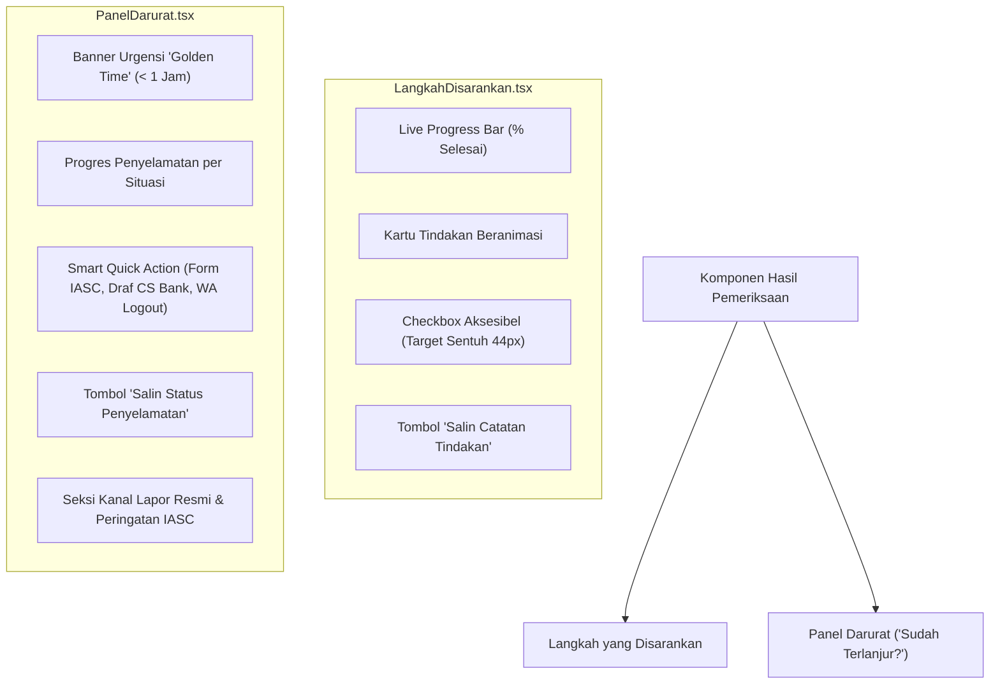

# Implementation Plan: Transformasi Checkbox Menjadi Dashboard Tindakan Interaktif

Dokumen ini merinci rencana teknis dan visual untuk mengganti checkbox statis pada bagian **"Langkah yang disarankan"** (`components/hasil/LangkahDisarankan.tsx`) dan **"Sudah terlanjur?"** (`components/hasil/PanelDarurat.tsx`) menjadi modul tindakan yang interaktif, informatif, dan praktis bagi pengguna.

---

## 1. Latar Belakang & Identifikasi Masalah

| Komponen | Implementasi Lama | Masalah / Keterbatasan |
| :--- | :--- | :--- |
| **`LangkahDisarankan.tsx`** | Menggunakan `<input type="checkbox">` di sebelah kanan setiap butir langkah. | **Pasif:** Pengguna hanya menandai coret (*strikethrough*) tanpa adanya umpan balik progres pencapaian, panduan mendalam, atau tombol aksi nyata. |
| **`PanelDarurat.tsx`** | Menggunakan `<input type="checkbox">` di samping kiri langkah darurat per situasi. | **Kurang Membantu di Saat Kritis:** Pengguna yang membuka panel darurat umumnya sedang panik. Checkbox polos tidak memberikan panduan cepat, format aduan ke bank, atau tombol pintasan darurat. |

---

## 2. Sasaran Perubahan (Design Goals)

1. **Lebih Interaktif & Responsif:** Memberikan visualisasi progres langsung (*live progress bar*) yang menghitung persentase langkah yang diselesaikan.
2. **Lebih Bermanfaat (Actionable):** Menyediakan tombol aksi cepat terintegrasi:
   - Pintasan langsung ke situs resmi IASC OJK.
   - Tombol salin template draf kronologi laporan transaksi ke CS bank.
   - Panduan cepat memutus sesi asing (misal: WhatsApp Web / akun perangkat tertaut).
3. **Ekspor / Catatan Tindakan:** Tombol satu-klik untuk menyalin status langkah (*checklist summary*) ke clipboard agar dapat diteruskan ke keluarga atau pihak berwenang.
4. **Indikator Urgensi (Golden Time):** Menyorot batas waktu kritis penyelamatan (misal: 30–60 menit pertama setelah transfer).
5. **100% Kompatibilitas & Aksesibilitas:** Mempertahankan semantik aksesibilitas WCAG 2.1 AA (target sentuh $\ge 44\text{px}$, navigasi keyboard, screen reader) dan menjamin 67 file pengujian unit Vitest tetap lulus tanpa regresi.

---

## 3. Rencana Arsitektur & Spesifikasi Fitur

---

## 4. Rincian Modifikasi Komponen

### A. `components/hasil/LangkahDisarankan.tsx`
- **Fitur 1: Dynamic Progress Tracker:**
  - Perhitungan progres: `Math.round((completedCount / totalItems) * 100)%`.
  - Progress bar dinamis yang berubah warna (biru saat berjalan, hijau emerald saat tuntas).
  - Teks status motivatif ramah pengguna (bebas kata mutlak terlarang seperti "pasti", "100% aman").
- **Fitur 2: Desain Kartu Langkah Interaktif:**
  - Kartu langkah responsif dengan transisi warna halus saat status selesai diaktifkan.
  - Mempertahankan `<input type="checkbox">` di dalam wadah berukuran minimal $44 \times 44\text{ px}$ untuk kepatuhan WCAG 2.1 AA dan pengujian unit.
- **Fitur 3: Tombol Salin Ringkasan Langkah:**
  - Menyalin daftar butir yang sudah dan belum diselesaikan dengan format rapi ke clipboard.

### B. `components/hasil/PanelDarurat.tsx`
- **Fitur 1: Kartu Informasi Urgensi Situasi (*Golden Time*):**
  - Khusus situasi berisiko tinggi (seperti `transfer`, `kirim_otp`, `isi_data`), disajikan kartu penanda waktu kritis (contoh: *30–60 menit pertama adalah peluang terbesar pemblokiran rekening tujuan*).
- **Fitur 2: Progres Penyelamatan Darurat:**
  - Progress bar penanganan darurat per tab situasi yang aktif.
- **Fitur 3: Bantuan Kontekstual & Template Instan (*Quick Action Helpers*):**
  - **Draf Kronologi Laporan Bank:** Tombol salin template yang langsung menyiapkan poin-poin penting (bank pengirim, nomor rekening pelaku, tanggal/jam transaksi, kerugian).
  - **Tautan Cepat IASC OJK:** Tautan terarah ke formulir pelaporan resmi di `iasc.ojk.go.id`.
  - **Panduan Cepat Putus Sesi WA:** Instruksi ringkas langkah logout perangkat tertaut.
- **Fitur 4: Salin Log Penyelamatan:**
  - Salin rangkuman tindakan darurat yang sudah diambil korban untuk ditunjukkan ke petugas bank atau kepolisian.

---

## 5. Rencana Pengujian & Verifikasi Mutu

1. **Unit Test Spesifik:**
   - Jalankan `npx vitest run components/hasil/LangkahDisarankan.test.tsx`
   - Jalankan `npx vitest run components/hasil/PanelDarurat.test.tsx`
2. **Integration & Accessibility Test:**
   - Jalankan `npx vitest run test/integration/responsivitas-aksesibilitas.test.tsx`
   - Pastikan target sentuh $\ge 44\text{px}$ dan peran `checkbox` terdeteksi dengan tepat.
3. **Audit Larangan Kata Terlarang (PRD Compliance):**
   - Jalankan `npx vitest run test/integration/audit-kata-terlarang.test.ts`
   - Memastikan tidak ada penggunaan kata mutlak (*aman*, *pasti*, *terbukti*, *100%*) sebagai klaim sepihak.
4. **Regresi Seluruh Proyek:**
   - Jalankan seluruh rangkaian tes: `npm run test` (memastikan ke-67 file pengujian tetap hijau 100%).

